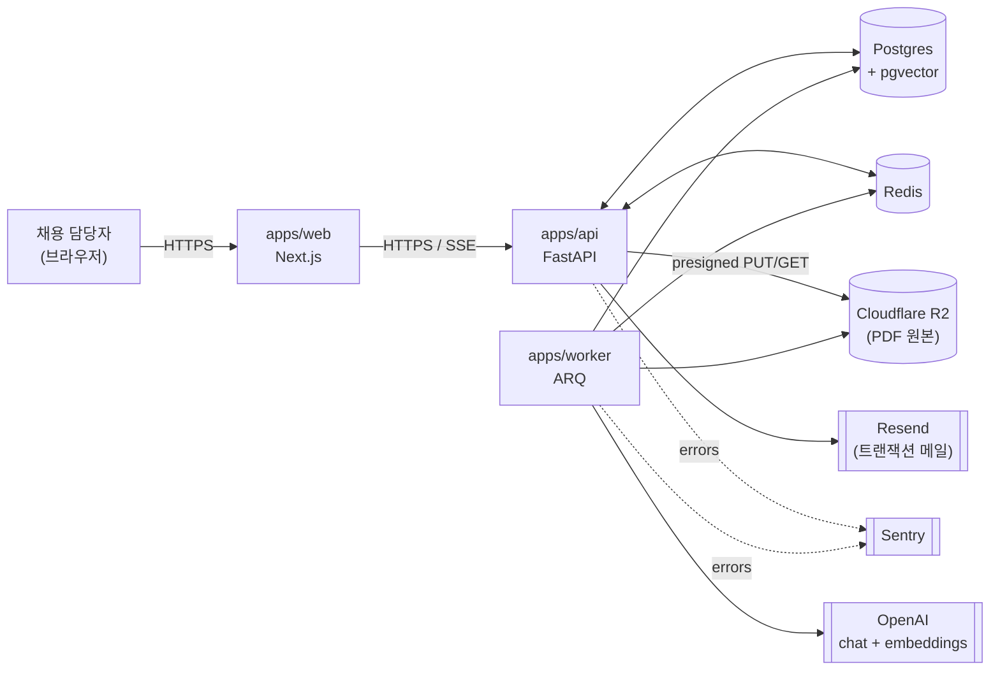
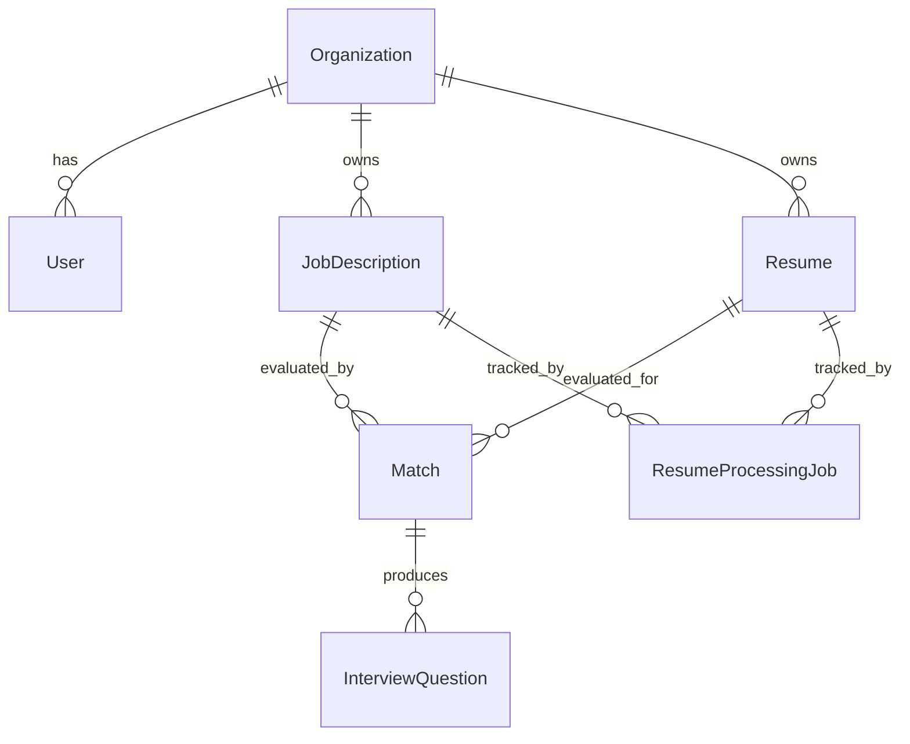
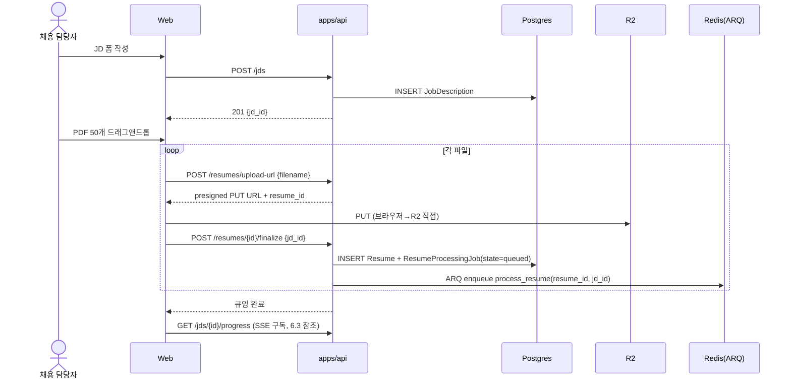
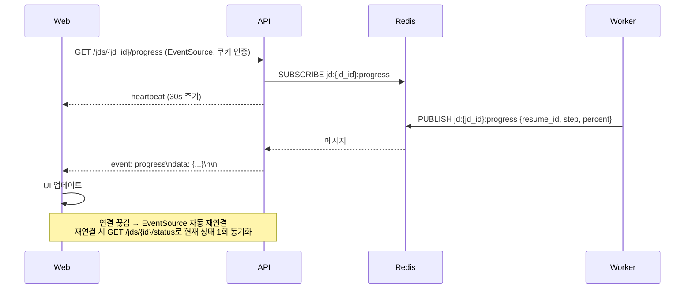

# ARCHITECTURE

> **독자**: AI 코딩 에이전트 + 미래의 메인테이너.
> **역할**: 지금 시스템이 어떻게 생겼는가의 지도. *왜* 이걸 골랐는지는 [`PLAN.md`](./PLAN.md).
> **상태 표식**: 🟡 Planned · 🟢 Implemented · 🔴 Deprecated. 코드가 따라잡으면 배지 갱신.
> **갱신 주기**: 모듈 경계·데이터 모델·외부 의존성이 바뀔 때마다 같은 PR에서 갱신.

---

## 1. Overview

채용 담당자가 JD(채용 공고)와 PDF 이력서들을 업로드하면, 시스템은 PDF를 파싱하고
LLM으로 키워드·요구사항을 추출하여 적합도를 상/중/하로 분류하고, 부족 역량 기반
면접 질문 3+개를 자동 생성한다. 상/중 합격자의 연락처를 CSV로 추출하여 다운로드
가능하다. 멀티테넌트 SaaS(조직 단위), 웹 전용.

---

## 2. System Context  🟡



외부 신뢰 경계: 브라우저 ↔ apps/web ↔ apps/api. 그 외 모든 통신은 사설망(Fly internal) 또는 인증된 외부 API.

---

## 3. Container View  🟡

| 컨테이너 | 책임 | 비상태/상태 | 배포 단위 |
|---|---|---|---|
| `apps/web` 🟢 인증/JD CRUD · 🟡 업로드/대시보드/SSE 구독 | UI, 인증 쿠키 관리, SSE 구독 | 비상태 | Fly app |
| `apps/api` | HTTP 핸들러, 인증, 큐 enqueue, SSE fan-out | 비상태 | Fly app |
| `apps/worker` | 이력서 처리 파이프라인 실행 (ARQ) | 비상태 | Fly app |
| Postgres (pgvector) | 영속 데이터 + 벡터 인덱스 | 상태 | Fly Postgres |
| Redis | ARQ 큐 + SSE pub/sub | 상태(휘발) | Fly Redis |
| Cloudflare R2 | PDF 원본 보관 | 상태 | 외부 매니지드 |

스케일 축:
- 트래픽 늘면 `apps/api`와 `apps/worker`만 머신 수 늘림(둘 다 무상태).
- DB는 수직 확장. 읽기 부하 늘면 read replica.
- SSE는 항상 Redis pub/sub fan-out을 거치므로 api 머신을 여러 개로 늘려도 누락 없음.

---

## 4. Module Map (`apps/api/app/`)  🟢

```
app/
├── main.py               # FastAPI 앱 + 미들웨어 + 핸들러 등록
├── routers/              # HTTP 어댑터 (얇음)
│   ├── auth.py
│   ├── jds.py
│   ├── resumes.py
│   ├── matches.py
│   └── progress.py       # SSE
├── services/             # 도메인 로직 + DB 접근
│   ├── jd_service.py
│   ├── resume_service.py
│   ├── matching_service.py
│   ├── llm.py            # LLMClient 추상화 (Port)
│   ├── pdf.py            # PDFExtractor 추상화 (Port)
│   ├── storage.py        # ObjectStorage 추상화 (Port)
│   └── scoring.py        # 가중치 기반 점수 계산 (pure)
├── tasks/                # ARQ 잡 함수 (worker가 import)
│   └── process_resume.py
├── models/               # SQLAlchemy ORM
└── core/
    ├── config.py         # pydantic-settings
    ├── db.py             # async engine, get_session 의존성
    ├── sse.py            # Redis pub/sub helper
    └── exceptions.py     # AppError 계층 + 핸들러
```

### 의존 방향 규칙 (강제, AGENTS.md와 연동)

```
routers ───────▶ services ───────▶ models
   │                │
   │                ├─▶ core
   │                │
   │                └─▶ services.llm / pdf / storage  (Port: 추상)
   ▼
core
```

- `routers/`는 HTTP에 특화. Pydantic 입출력, 인증 의존성, 호출 → `services/`.
- `services/`는 SQLAlchemy 세션을 *인자로 받는다*. `commit()`을 호출하지 않는다.
- `tasks/`는 *자신의 트랜잭션 경계*를 관리하며 `services/`를 호출한다.
- `models/`는 누구나 import 가능, 누구도 import 하지 않음(엔티티 정의만).
- `core/`는 누구나 import 가능, 외부로 의존 없음.
- 역방향 import 금지: `services → routers` 금지, `core → services` 금지.

### Port/Adapter

세 곳에만 인터페이스를 둔다(나머지는 평범하게 짠다):

| Port | 위치 | 1차 구현 | 잠재 구현 |
|---|---|---|---|
| `LLMClient` | `services/llm.py` | 인터페이스(Protocol) 🟢 · `OpenAIClient` 구현 🟡 | Anthropic, Gemini |
| `PDFExtractor` | `services/pdf.py` | 인터페이스(Protocol) 🟢 · `PdfplumberExtractor` 🟢(텍스트 PDF) · `TesseractFallback` 🟡(OCR PR) | AWS Textract, Document AI |
| `ObjectStorage` | `services/storage.py` | `S3CompatStorage` (R2/MinIO 공용) 🟢 | 다른 S3 호환 백엔드 |

---

## 5. Core Data Model  🟢



| 엔티티 | 핵심 필드 | 메모 |
|---|---|---|
| `Organization` | id, name, created_at, updated_at | 멀티테넌시 루트 🟢 |
| `User` | id, email, hashed_password, is_active/superuser/verified, org_id, created_at, updated_at | fastapi-users 관리, 가입 시 1인 워크스페이스 자동 생성 🟢 |
| `JobDescription` | id, org_id, title, raw_text, requirements_json, embedding(vector 1536) | 재사용 가능 🟢 |
| `Resume` | id, org_id, pdf_key, parsed_text, sections_json, contact_json, parse_confidence, embedding | 동일 후보가 여러 JD에서 평가 가능 🟢 |
| `Match` | id, jd_id, resume_id, overall_score, category_scores_json, grade, matched_keywords_json, missing_keywords_json | UNIQUE(jd_id, resume_id) 🟢 |
| `InterviewQuestion` | id, match_id, question, question_type, order, edited_by_user | 사용자 편집 추적 🟢 |
| `ResumeProcessingJob` | id, resume_id, jd_id, state, error_json, started_at, finished_at, step_state_json | ARQ 외부 상태 거울 🟢 |
| `LlmCall` | id, purpose, model, prompt, response, tokens_in, tokens_out, latency_ms, cost_usd, created_at | 자체 관찰성 🟢 |

벡터: `Resume.embedding`, `JobDescription.embedding`은 `pgvector.Vector(1536)` (text-embedding-3-small). 인덱스는 `ivfflat (vector_cosine_ops)`. 컬럼·인덱스는 도입됨(🟢), 실제 임베딩 채우기는 파이프라인 PR에서.

---

## 6. Key Flows

### 6.1 JD 생성 → 이력서 일괄 업로드 → 파이프라인 트리거  🟢 (ARQ enqueue·SSE 제외 🟡)



업로드 파일은 브라우저 → R2 직접(presigned PUT)으로 가서 백엔드 대역 부담을 줄인다. 백엔드는 메타데이터만.

**구현 상태**: `POST /jds`(생성·목록·상세), `POST /resumes/upload-url`(presigned PUT 발급 + `Resume` row), `POST /resumes/{id}/finalize`(`ResumeProcessingJob(state="queued")` 생성)까지 🟢. **ARQ enqueue는 아직 미동작**(워커 핸들러 미구현) — finalize는 잡 row만 만들고 큐잉은 파이프라인 PR에서. SSE 구독(§6.3)도 별도 PR.

### 6.2 이력서 1건 처리 파이프라인 (워커 내부)  🟢 (실 OpenAI/PDF 어댑터·Redis 발행 제외 🟡)

```mermaid
sequenceDiagram
    participant ARQ as ARQ Worker
    participant DB
    participant R2
    participant LLM as OpenAI
    participant Redis

    Note over ARQ: process_resume(resume_id, jd_id)
    ARQ->>DB: load ResumeProcessingJob.state
    alt parsed_at is null
        ARQ->>R2: GET pdf
        ARQ->>ARQ: PDFExtractor.extract()
        Note right of ARQ: 텍스트 부족 시 Tesseract OCR 폴백
        ARQ->>DB: BEGIN; UPDATE Resume.parsed_text; COMMIT
        ARQ->>Redis: PUBLISH progress (step=parsed)
    end
    alt keywords_at is null
        ARQ->>LLM: extract_keywords()
        ARQ->>DB: BEGIN; UPDATE Resume.sections/contact; INSERT LlmCall; COMMIT
        ARQ->>Redis: PUBLISH progress
    end
    alt embedded_at is null
        ARQ->>LLM: embed()
        ARQ->>DB: BEGIN; UPDATE Resume.embedding; INSERT LlmCall; COMMIT
        ARQ->>Redis: PUBLISH progress
    end
    ARQ->>DB: BEGIN; compute Match score (scoring.py); INSERT Match; COMMIT
    ARQ->>Redis: PUBLISH progress (step=scored)
    alt grade in (상, 중)
        ARQ->>LLM: generate_questions() + validate()
        ARQ->>DB: BEGIN; INSERT InterviewQuestion[]; COMMIT
        ARQ->>Redis: PUBLISH progress (step=done)
    end
```

**중요 불변식**:
- LLM/R2 호출 시점에는 DB 트랜잭션이 *닫혀 있다*. 트랜잭션은 결과 저장 직전에만 짧게 연다.
- 각 단계는 자기 결과를 commit한다. 다음 단계가 실패해도 비싸게 만든 이전 결과는 살아남는다.
- 잡은 시작 시 `ResumeProcessingJob.step_state_json`을 보고 완료된 단계는 skip → idempotent 재시도.
- R2 객체 키는 `org_{org_id}/resume_{resume_id}.pdf`로 결정적. 재시도 중복 업로드 OK.

**구현 상태**: 오케스트레이션 `app/tasks/process_resume.py:run_resume_pipeline` 🟢 — 단계별 트랜잭션·멱등(`step_state_json`)·LlmCall 기록·Match upsert·상/중 등급에서만 질문 생성·실패 시 `state="failed"`/`error_json`. 스코어링 `app/services/scoring.py`(순수, 코사인+키워드 가중합, 상≥0.75/중≥0.5/하) 🟢. `PdfplumberExtractor`(`app/services/pdf.py`) 🟢 — 텍스트 PDF에서 한+영 추출, 텍스트 부족 시 `PdfParseFailed`. `finalize` → ARQ `process_resume` enqueue 🟢(`app/services/resume_service.py` + `app/core/queue.py`의 lazy 풀). 워커는 PDF 어댑터 와이어링 완료 🟢. `ProgressPublisher` 인터페이스 🟢 + `NoopProgressPublisher` 기본, 실 Redis 발행 🟡(SSE PR). `OpenAIClient` 🟡(다음 어댑터 PR — VCR 카세트). Tesseract OCR 폴백 🟡(OCR PR). 현 단계 워커 실행은 parsed 단계까지만 성공하고 analyzed에서 `NotImplementedError`로 실패한다.

### 6.3 SSE 진행률 구독  🟢



**중요**:
- 진실 원천은 DB(`ResumeProcessingJob`). SSE는 *푸시* 채널일 뿐. 클라가 새로 들어오면 DB에서 현재 상태 GET 후 SSE 구독.
- 응답 헤더: `Cache-Control: no-cache`, `X-Accel-Buffering: no`.
- EventSource는 커스텀 헤더 못 보냄 → 쿠키(`HttpOnly`, `SameSite=Lax`) 인증.

**구현 상태**: `RedisProgressPublisher`(`app/core/sse.py`) 🟢 — 채널 `jd:{jd_id}:progress`에 JSON 발행. 라우터 `GET /jds/{id}/progress`(`app/routers/progress.py`) 🟢 — `StreamingResponse(text/event-stream)` + 헤더(`Cache-Control: no-cache`, `X-Accel-Buffering: no`, `Connection: keep-alive`), heartbeat 간격 `Settings.sse_heartbeat_seconds`(운영 30s). 재연결 동기화용 `GET /jds/{id}/status` 🟢 — 해당 JD의 `ResumeProcessingJob` 목록 반환. 워커 `on_startup`이 `RedisProgressPublisher`를 ctx에 주입 🟢. 프론트엔드 `EventSource` 클라이언트 🟡(apps/web 후속).

---

## 7. Cross-cutting Concerns

### 7.1 인증 / 권한  🟢 (RBAC 제외 🟡)

- **fastapi-users 14.x + httpx-oauth(Google)**. 쿠키 전략(`HttpOnly`, `SameSite=Lax`, `Secure`는 운영 환경에서만). JWT를 쿠키에 직렬화하여 SSE EventSource와 자연스럽게 호환.
- 엔드포인트: `/auth/register`, `/auth/cookie/{login,logout}`, `/users/me`, `/auth/google/{authorize,callback}`(OAuth 키가 설정된 경우에만 라우터 등록).
- **조직 자동 생성**: 가입 직후 `UserManager.on_after_register` 훅이 `Organization`을 만들고 `user.org_id`에 연결한다. 1인 워크스페이스 패턴(팀 초대 흐름은 별도 PR로 분리).
- 모든 보호 라우터는 `current_user: User = Depends(current_active_user)` 의존성을 받음(`app.core.auth.current_active_user`).
- **테넌트 격리**: 모든 쿼리는 `WHERE org_id = current_user.org_id`로 필터. services 함수가 `user` 또는 `org_id`를 인자로 받는 것을 *강제*. DB 레벨 RLS는 도입하지 않음(Postgres에 직접 SQL 실행하는 경로가 없는 한 services 필터로 충분).
- **RBAC / 역할**: 현재 미도입. 멤버는 동등 권한이며 admin 비트는 fastapi-users 기본 `is_superuser` 한 단계만 존재. 필요해지면 별도 설계로 진행.

### 7.2 트랜잭션 경계  🟡

- **HTTP**: `Depends(get_session)`이 요청당 트랜잭션 1개를 자동 관리. 핸들러가 정상 return → commit, 예외 → rollback. `services/*`는 `session.commit()`을 호출하지 않는다.
- **ARQ task**: §6.2처럼 단계별로 새 세션을 열고, 외부 호출은 트랜잭션 밖에서, 결과 저장만 트랜잭션 안에서. 잡은 idempotent해야 한다(중복 실행 시 이전 단계 결과 보존).
- **services는 `session.flush()`만**, `commit()`은 호출하는 쪽(라우터/잡)의 책임.

### 7.3 에러 처리  🟡

```python
class AppError(Exception):
    code: str          # 안정 식별자 ("RESUME_NOT_FOUND")
    http_status: int   # 404
    message_ko: str    # 사용자 표시용
    details: dict      # 로그/Sentry용
```

- 도메인 예외는 `AppError` 하위로 정의 (`ResumeNotFound`, `PdfParseFailed`, `JdRequirementsExtractionFailed` 등).
- 글로벌 핸들러가 → `{"error": {"code": ..., "message": ...}}` 응답으로 매핑.
- 라우터에서 `raise HTTPException(...)` 직접 사용 금지(AGENTS.md §6).
- 프론트는 `code`로 분기, `message`를 표시. 메시지 문구가 바뀌어도 분기 깨지지 않음.
- 미처리 예외 → Sentry + 500 + 일반 메시지.

### 7.4 관찰성  🟡

- **구조화 로그**: structlog (JSON). request_id, user_id, org_id, job_id를 context로 묶음. Fly logs.
- **에러 트래킹**: Sentry (web, api, worker 모두).
- **LLM 호출**: 모든 호출은 `LlmCall` 테이블에 기록. SQL로 프롬프트·응답·토큰·비용 조회. Langfuse는 유보.
- **메트릭**: 현 단계는 의도적으로 미도입.

### 7.5 시크릿 / 설정  🟢

- `apps/api/app/core/config.py`의 `Settings(BaseSettings)`가 환경변수에서만 읽음.
- 운영: `fly secrets set`. 로컬: `.env` (gitignored). `.env.example`만 커밋.
- DB/Redis/R2/OpenAI 키는 코드에 절대 하드코딩 금지(AGENTS.md §8).

---

## 8. Extension Points

어떤 외부 의존성을 갈아끼우려면 *어디만 만지나*를 정리한다. 모두 Port 인터페이스가 정의되어 있고, 1차 구현체와 같은 위치에 있다.

| 갈아끼울 대상 | 파일 | 만져야 할 곳 | 비고 |
|---|---|---|---|
| LLM 공급자 | `services/llm.py` | `LLMClient` 인터페이스 구현체 추가 + `Settings.llm_provider` 분기 | 응답을 OpenAI Structured Outputs 호환 dict로 정규화. |
| PDF 추출기 | `services/pdf.py` | `PDFExtractor` 구현체 추가 + `Settings.pdf_extractor` 분기 | 신뢰도 메트릭(`PdfExtractResult.confidence`) 반환 의무. |
| 오브젝트 스토리지 | `services/storage.py` | endpoint_url·credentials만 다름. `Settings.s3_*` 변경 | S3/R2/MinIO 모두 같은 boto3 코드. |
| 적합도 가중치 | `services/scoring.py` + `core/config.py` | `Settings.scoring_weights`(JSON) 환경변수 외부화 | pure function, 단위 테스트 용이. |
| 트랜잭션 메일 발송 | `services/email.py` 🟡 (예정) | `EmailSender` 구현체 추가 | Resend 1차, SES 잠재. |

---

## 9. 의도적으로 안 한 것

다음은 *알면서 미룬* 결정이다. 시기상조이거나 yagni:

- Read replica / multi-region
- OpenTelemetry / Prometheus
- Langfuse · LLM 평가 자동화 CI
- DB-level Row Level Security
- Kafka 등 외부 메시지 브로커 (Redis pub/sub로 충분)
- 모바일 / 네이티브 앱
- 조직 단위 역할(RBAC) — MVP는 조직 멤버 = 동등 권한

이 중 도입이 필요해지는 시점은 PR 설명에 함께 적고, ARCHITECTURE.md를 같이 갱신한다.
